# AIBuilder

Guided builder NPCs for Paper servers: built-in models without any AI key, custom builds planned through your own OpenRouter key, and every plan confirmed by a player before construction starts.

[English](#english) · [Português](#português)

---

<a id="english"></a>

## English

AIBuilder is a Paper plugin that lets players guide named builder NPCs. Builders can place original built-in models **without an AI service**, or plan custom builds through **OpenRouter**. Every AI plan needs player confirmation before construction starts. Questions and confirmation previews appear in bold yellow; chat buttons use green to confirm and red to cancel.

Menus, help, and chat support English (`EN`, default) and Portuguese (`PT`). Command words always use English (`/builder`).

### Gallery

Screenshots from a live Paper server (see `examples/` for the full set):

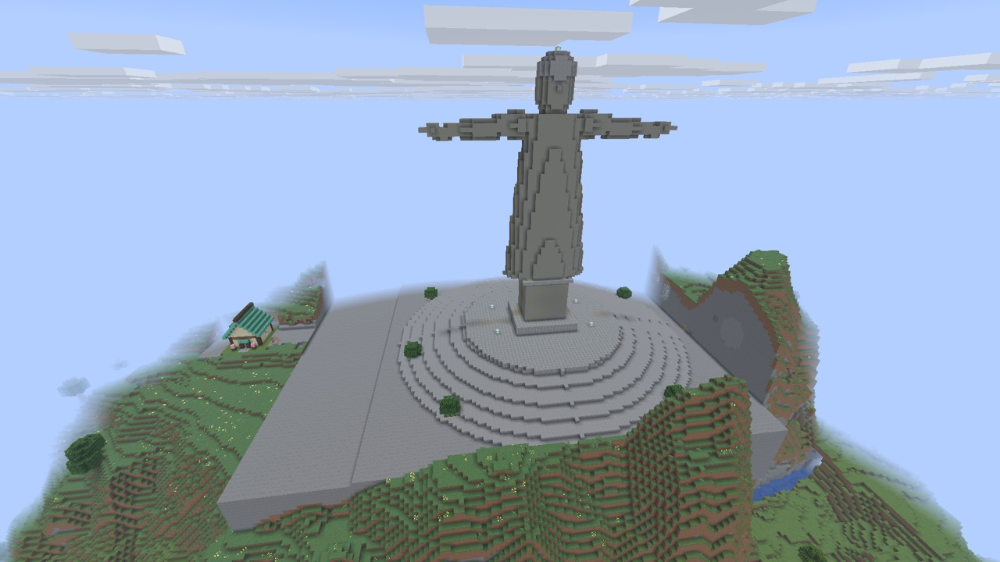
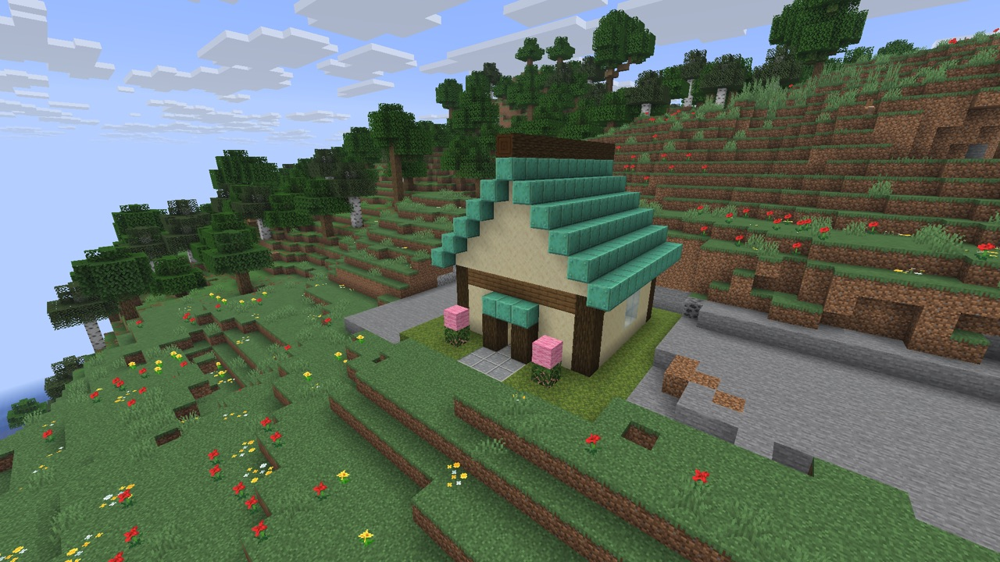
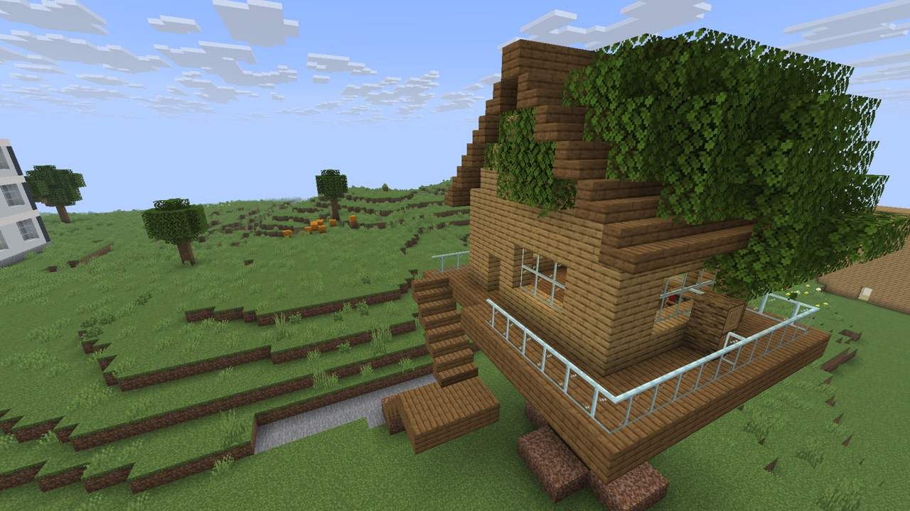
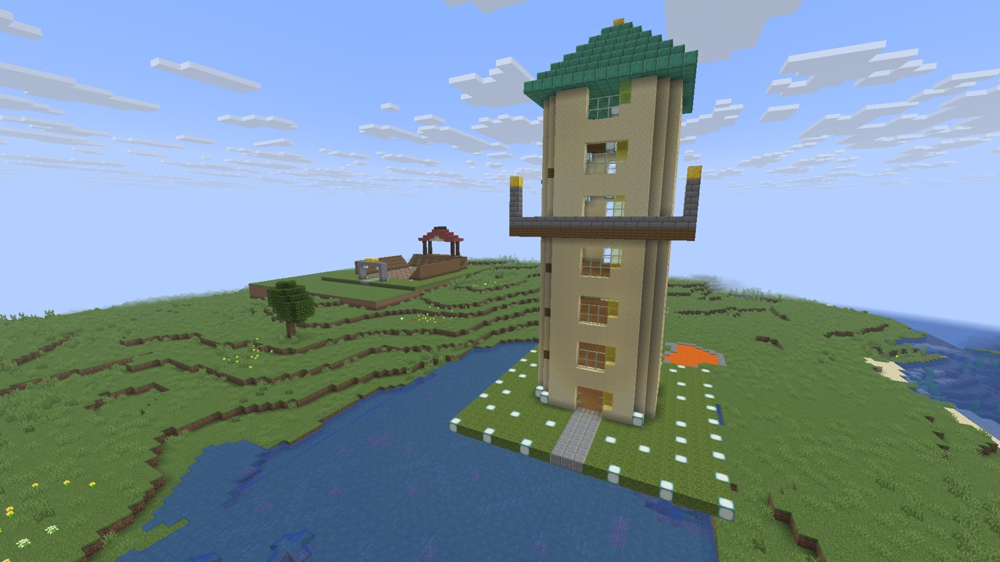
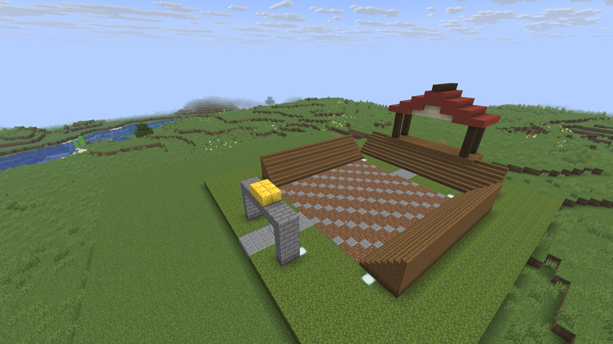
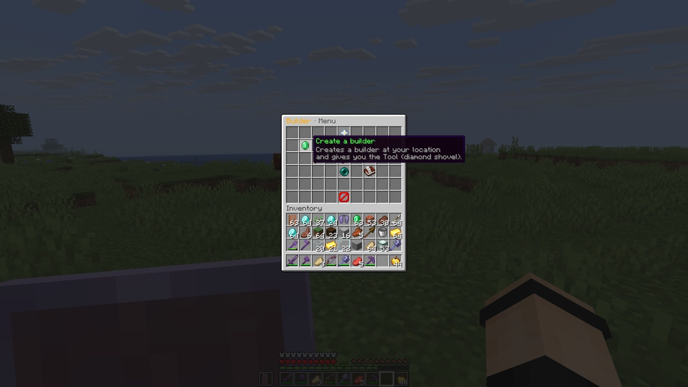
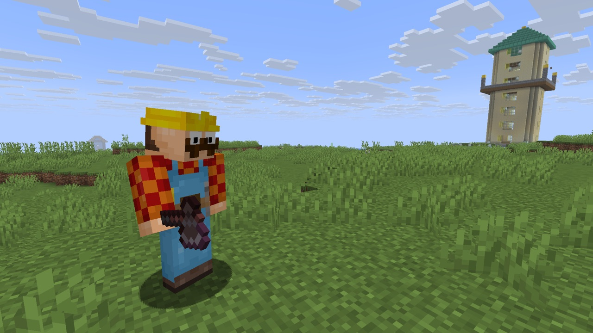
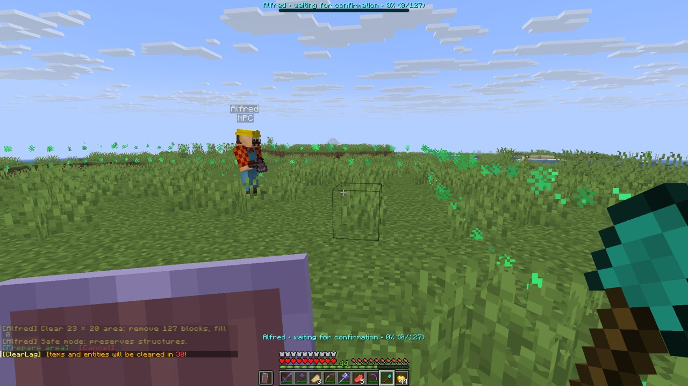
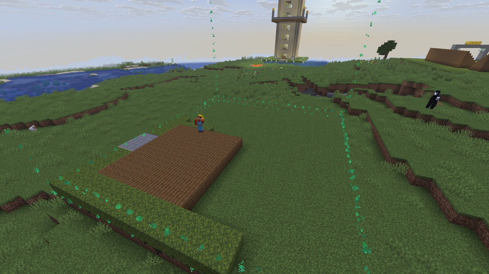
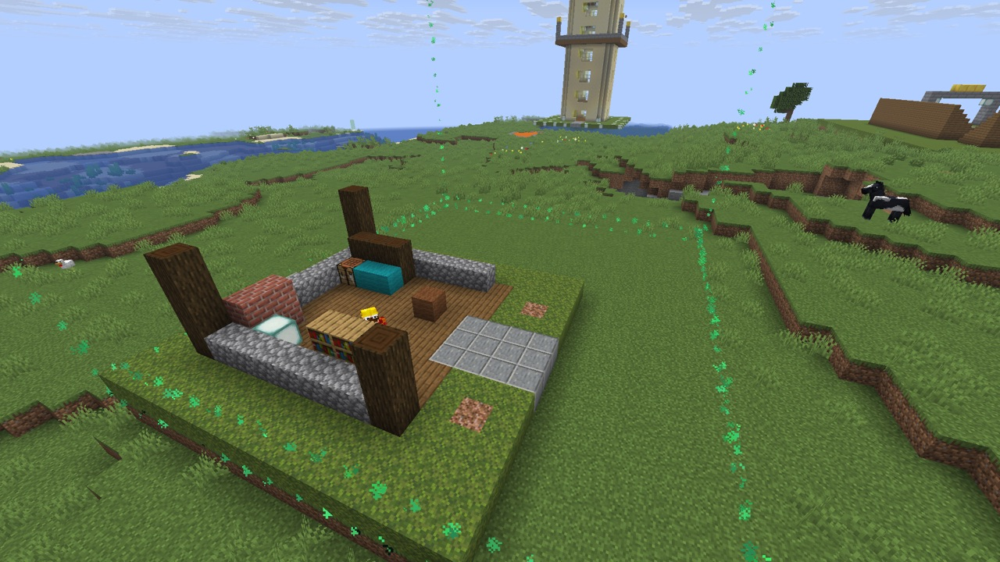
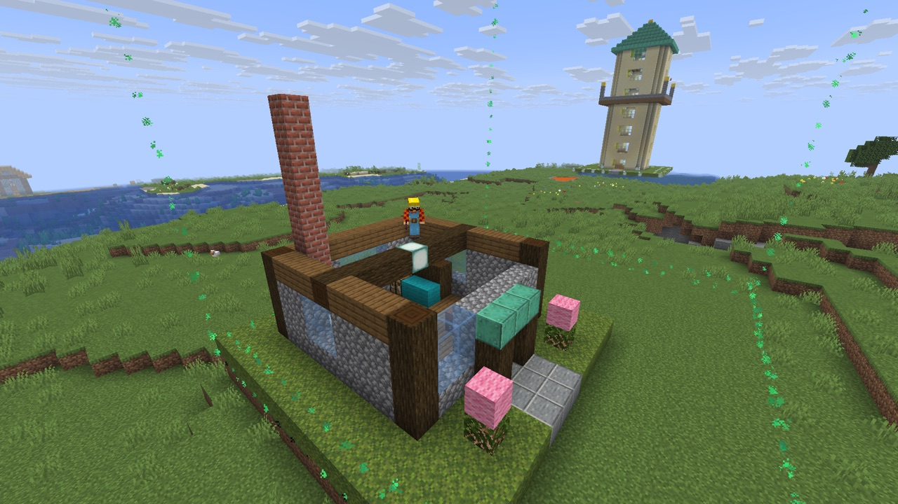
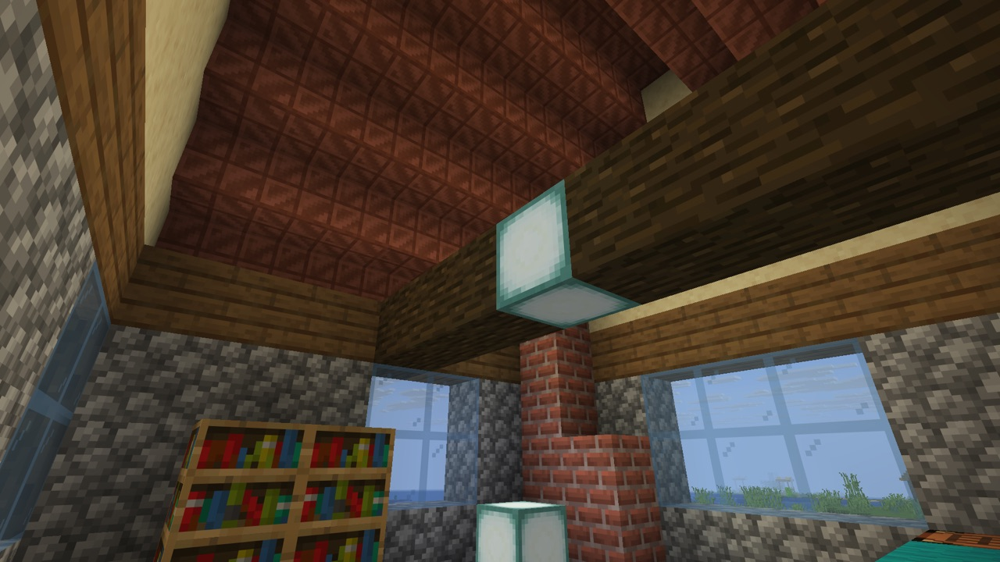
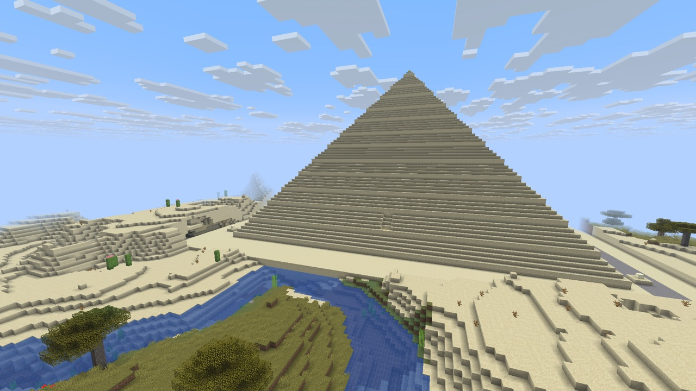
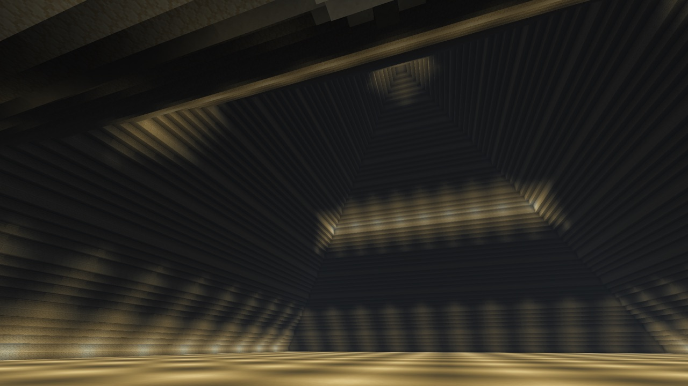

### Requirements

- **Paper** server (developed and tested on Paper 26.3; `api-version: '1.21'`)
- **Java 25**
- No hard dependencies. **Optional:** GriefPrevention (claim protection), CoreProtect (block history), OpenRouter API key (only for custom AI builds)

### Installation

1. Put `AIBuilder-1.0.0.jar` in the server's `plugins/` folder.
2. Start Paper. The plugin creates `plugins/AIBuilder/` (with `config.yml`, `languages/`, `prebuilts/`, and the in-game doc kit).
3. Configure (optional): edit `plugins/AIBuilder/config.yml`. Set `language: EN` or `PT`, then run `/builder reload`.
4. To use custom AI builds, add your OpenRouter key (see [AI custom builds](#ai-custom-builds-openrouter)).

### Quick start

1. Open the menu with `/builder` or `/construtor`.
2. Choose **Create builder** and mark an area with the diamond shovel (left click corner 1, right click corner 2).
3. Choose a built-in model to build **without an AI key**, or write a chat request for a custom build.
4. For pre-built models, the plugin first shows the required area (x/y/z extents, total volume, block count) and the material list (needed vs owned) so you can mark the area for cleaning/leveling.
5. Inspect each preview and confirm or cancel. The builder only changes blocks after confirmation.

### Built-in models (no AI key)

These are compiled into the plugin and work immediately: Country Cottage (`casa_campo`), Modern House (`casa_moderna`), Modern Cube Home (`cubo_moderno`), Ranch House (`casa_rasa`), Giant Oak Tree (`arvore_gigante`), Modern 3-Story Building (`predio_moderno_3_andares`), and Treehouse (`casa_na_arvore`).

### Extra constructions (downloadable packs)

Beyond the 7 built-in models, this release includes **57 extra constructions** as downloadable packs (see `publication/prebuilt-packs/`):

| Pack | Constructions |
|---|---:|
| Monumentos-do-Mundo-Volume-1 | 16 world monuments (Colosseum, Eiffel Tower, Taj Mahal, …) |
| Reinos-Medievais-Volume-1 | 16 medieval buildings (castles, abbeys, guild market, …) |
| Vila-Viva-Volume-1 | 16 village buildings (bakery, tavern, mill, …) |
| Casas-Village-Volume-1 | 7 biome village houses |
| Castelos-e-Casas-Volume-1 | 2 (Cinderella Castle, Modern Cube Home) |

**How to use a pack (server operator):**

1. Extract the zip.
2. Copy the `.json` files — top level only, no subfolders — into `plugins/AIBuilder/prebuilts/`.
3. Run `/builder reload`, then `/builder prebuilt list` to see each construction's `id`, title, and required area.
4. In game: mark an area, then `/builder <builder-name> prebuilt <id>` and confirm.

Each pack contains the JSON files plus its own `README.md` (EN/PT), `manifest.json`, and `LICENSE-MIT.txt`, and a `.sha256` sidecar to verify integrity. The full inventory is in `publication/prebuilt-packs/INVENTARIO.md`.

**Limits that apply to user models:** max 256 user models per server (`prebuilt.max-user-models`), file size up to `construction.max-file-bytes` (default 64 MiB), height up to 100 blocks. **Full solid blocks only** — doors, beds, stairs, slabs, torches, carpets, plants, and fluids are not supported by the executor. Coordinates are relative to the marked area's minimum corner. Files whose `id` collides with an existing one are skipped; invalid JSON is logged and ignored.

**Making your own:** put a JSON file in `plugins/AIBuilder/prebuilts/` following the format documented in the generated `prebuilts/LEIA-ME.md`, `PROMPT-EN.md`, and the `exemplo_abrigo.json.example` file (copied with the plugin on first run). The plugin validates them and refreshes the catalog automatically.

### AI custom builds (OpenRouter)

Edit `plugins/AIBuilder/config.yml` on your server:

```yaml
api-key: YOUR_OPENROUTER_KEY      # keep private; costs apply per request (billed by OpenRouter)
model: deepseek/deepseek-v4-flash-0731
```

Then run `/builder reload` and talk to the builder in chat:

```text
/builder spawn
/builder alfred zone set1
/builder alfred zone set2
@alfred build a small stone cottage with a garden
/builder alfred yes
```

Without a key, AI chat explains how to configure one; built-in models and all other non-AI tools keep working. The `model` value is the provider's model identifier — set the exact ID available to your account. Parental controls (`parental.allowed-hours`, `parental.daily-limit`) apply only to AI requests.

### Commands

All commands may start with `/builder`, `/aibuilder`, or the legacy `/construtor`. A command can target a builder by name, e.g. `/builder alfred status`. Without a name, it uses the selected builder. Names are Alfred, Bruce, Clark, Diana, and Tony. Chat requests use `@<builder-name> <request>`.

| Command | Use |
|---|---|
| `spawn` | Create a builder at your location and select it |
| `list` | List your builders and their status |
| `select <name>` | Select one of your builders |
| `menu` | Open the clickable menu (no arguments also opens it) |
| `help` | Show commands and examples |
| `settings` | Show configuration tips in chat |
| `settings language EN\|PT` | Change the interface language (operator only) |
| `reload` | Reload the config and built-in/user models (operator only) |
| `delete` | Remove an idle builder and its tool (saved build records are kept) |
| `status` | Show position, queue, selected area, and build state |
| `tool` | Get the selection shovel; left click corner 1, right click corner 2 |
| `yes` | Confirm a pending plan |
| `cancel` / `no` | Cancel a request, preview, or running operation; placed blocks are kept and the active build is saved |
| `stay` / `follow` | Stop following / walk after the owner (a confirmed build continues in Stay mode) |
| `stop` | Cancel queued work, discard a pending plan, and pause the current build |
| `call` / `call all` | Bring your builder(s) near you to a safe location; pauses work (resume with Follow or Build > Continue) |
| `distance <4..64>` | Set the maximum owner distance in blocks |
| `zone set1\|set2\|show\|clear` | Mark, view, or remove the build area |
| `terrain inspect` | Read the selected terrain without changing blocks |
| `terrain clean` | Preview and remove only classified vegetation (grass/plants, tree logs and leaves, flowers, vines, moss, similar growth), then confirm with `terrain clean yes` |
| `terrain level` | Preview leveling to the most common surface height; vegetation is cleared first in the same confirmed plan |
| `terrain cancel` | Stop terrain work; changes already applied remain |
| `terrain deep clean\|level` | Optional operator-only deep clean (requires `terrain.deep-clean.enabled: true`; removes structures, liquids, and bedrock inside the box) |
| `prebuilt list` / `prebuilt <id>` | List or select a built-in or imported model without AI |
| `orientation north\|south\|east\|west\|original` | Set the entrance direction for future built-in models |
| `build` | Show the active build's progress |
| `build save` | Save the open build and pause its queue (resume with `build continue [name]`) |
| `build continue [name]` | Continue a named saved build from chat, or open the unfinished-build menu |
| `build speed [on\|off]` | Operator-only fast mode: the builder hovers in place and skips physical travel checks (area, material, claim, world-border, spawn, and protection-event checks still apply) |
| `build undo` | Safely remove unchanged blocks placed by the open build, when enabled |
| `build finish` | Close the current build; later requests start a new build |
| `project corner1\|corner2\|save <name>\|list\|place <name>` | Save and place a player-created block project |
| `mission` | View mission progress and earned rewards |
| `parent hours\|limit\|history` | Configure parental controls (operator only; legacy: `pais`) |

### Configuration

Edit `plugins/AIBuilder/config.yml`, then run `/builder reload`. Key defaults:

| Option | Default | Meaning |
|---|---|---|
| `builders.max` | `3` | Maximum builders on the server (1–5) |
| `max-project-blocks` | `2500` | Maximum blocks in one project |
| `max-blocks-per-minute` | `600` | Block actions per minute |
| `construction.max-width/depth/height` | `200` each | Maximum box dimensions |
| `prebuilt.max-user-models` | `256` | Maximum imported JSON models (hard limit) |
| `prebuilt.free-materials` | `true` | Free catalog assembly (set `false` to use the owner's inventory) |
| `use-owner-inventory` | `true` | Use the owner's inventory for placed materials |
| `creative-mode` | `false` | Unlimited materials for the builder |
| `allow-break-without-coreprotect-in-selection` | `true` | Without CoreProtect, allow natural terrain/vegetation removal only inside a confirmed selection |
| `terrain.deep-clean.enabled` | `false` | Enables destructive deep clean/level for operators |
| `follow-owner` | `true` | Default follow behavior for new builders |

Start with conservative block and volume limits, then increase one limit at a time while watching server performance. The clickable Settings menu groups global options, build limits, movement/terrain, and AI/timeouts — every option is also editable in `config.yml`.

### Safety and behavior

- Only the builder's owner or a server operator can control that NPC. The global command permission `aibuilder.use` defaults to operators; grant it deliberately if regular players should use it.
- AI-generated work is checked against server-side dimensions, materials, area, block budget, and protections. Players confirm every plan before it runs.
- Build zones, world height/borders, and the spawn exclusion zone stay enforced. GriefPrevention claims remain protected; a broken claim integration fails closed.
- Environment-dependent behavior worth knowing: without CoreProtect, the plugin cannot distinguish player-placed dirt/grass/stone from natural terrain. The default permits removing natural terrain/vegetation only inside the confirmed selection; set `allow-break-without-coreprotect-in-selection: false` for fully conservative behavior.
- Terrain cleaning/leveling always uses a preview and confirmation; cancelling keeps changes already made. Deep clean is operator-only, off by default, and can remove structures inside the selected box; external protection plugins remain authoritative.
- The builder never attacks players — only hostile monsters, and only with an empty queue. Follow uses bounded physical walking; it does not teleport (only `call` teleports, to a safe location, and pauses work).

### Troubleshooting

- **"out of the zone" / area too small:** the plugin first shows the required area for models; mark exactly that area. A flat selection (same Y for both corners) is extended by `zone.build-height` (default 100) when saved — check `config.yml` if blocks above ground are refused.
- **A plan is refused mid-build:** read `plugins/AIBuilder/actions.log` (timestamps are UTC) next to `logs/latest.log` (server local time). Look for `[recusado]` lines, then check `plugins/AIBuilder/builds/<name>.json` status.
- **Building never starts:** every construction needs a freshly marked area with the diamond shovel (or `/construtor terreno limpar` / `/construtor zona`), and a confirmed plan uses it up. Confirm with `/builder yes` — plans never auto-start.
- **AI requests fail:** is `api-key` set in `plugins/AIBuilder/config.yml` and is the `model` ID valid on your OpenRouter account? Run `/builder reload` after changing. Built-in models don't need a key.
- **NPC didn't move / stuck mid-air:** flying without a full safe route returns no path on purpose; the builder retries automatically. If a player is standing inside the destructive work area, terrain work waits and resumes when the area is clear.

### Feedback

This is a community-maintained plugin (MIT License, © 2026 elitonvita). Issues and suggestions: open an issue on the project page.

---

<a id="português"></a>

## Português

O AIBuilder é um plugin para Paper que permite aos jogadores guiar NPCs construtores nomeados. Os construtores podem posicionar modelos originais embutidos **sem nenhum serviço de IA**, ou planejar construções personalizadas através do **OpenRouter**. Cada plano de IA precisa da confirmação do jogador antes de a construção começar. Perguntas e prévias de confirmação aparecem em amarelo negrito; os botões no chat usam verde para confirmar e vermelho para cancelar.

Menus, ajuda e chat funcionam em inglês (`EN`, padrão) e português (`PT`). As palavras de comando usam sempre inglês (`/builder`).

### Requisitos

- Servidor **Paper** (desenvolvido e testado no Paper 26.3; `api-version: '1.21'`)
- **Java 25**
- Nenhuma dependência obrigatória. **Opcionais:** GriefPrevention (proteção de claims), CoreProtect (histórico de blocos), chave de API do OpenRouter (somente para construções personalizadas com IA)

### Instalação

1. Coloque o `AIBuilder-1.0.0.jar` na pasta `plugins/` do servidor.
2. Inicie o Paper. O plugin cria `plugins/AIBuilder/` (com `config.yml`, `languages/`, `prebuilts/` e o kit de documentação no jogo).
3. Configure (opcional): edite `plugins/AIBuilder/config.yml`. Defina `language: EN` ou `PT` e rode `/builder reload`.
4. Para usar construções personalizadas com IA, cadastre sua chave do OpenRouter (ver [Construções personalizadas com IA](#construções-personalizadas-com-ia-openrouter)).

### Começando

1. Abra o menu com `/builder` ou `/construtor`.
2. Escolha **Create builder** (criar construtor) e marque uma área com a pá de diamante (clique esquerdo = canto 1, clique direito = canto 2).
3. Escolha um modelo embutido para construir **sem chave de IA**, ou escreva um pedido no chat para uma construção personalizada.
4. Para modelos pré-definidos, o plugin primeiro mostra a área necessária (extensões x/y/z, volume total e contagem de blocos) e a lista de materiais (necessários × que o dono já tem), para você marcar a área de limpeza/nivelamento.
5. Inspecione cada prévia e confirme ou cancele. O construtor só altera blocos após a confirmação.

### Modelos embutidos (sem IA)

Estes estão compilados no plugin e funcionam imediatamente: Casa de Campo (`casa_campo`), Casa Moderna (`casa_moderna`), Cubo Moderno (`cubo_moderno`), Casa Rústica (`casa_rasa`), Carvalho Gigante (`arvore_gigante`), Edifício Moderno de 3 Andares (`predio_moderno_3_andares`) e Casa na Árvore (`casa_na_arvore`).

### Construções extras (pacotes para baixar)

Além dos 7 modelos embutidos, esta release inclui **57 construções extras** em pacotes para baixar (ver `publication/prebuilt-packs/`):

| Pacote | Construções |
|---|---:|
| Monumentos-do-Mundo-Volume-1 | 16 monumentos do mundo (Coliseu, Torre Eiffel, Taj Mahal, …) |
| Reinos-Medievais-Volume-1 | 16 construções medievais (castelos, abadias, mercado das guildas, …) |
| Vila-Viva-Volume-1 | 16 construções de vila (padaria, taverna, moinho, …) |
| Casas-Village-Volume-1 | 7 casas de vila por bioma |
| Castelos-e-Casas-Volume-1 | 2 (Castelo da Cinderela, Cubo Moderno Habitável) |

**Como usar um pacote (operador do servidor):**

1. Extraia o zip.
2. Copie os arquivos `.json` — somente nível superior, sem subpastas — para `plugins/AIBuilder/prebuilts/`.
3. Rode `/builder reload` e depois `/builder prebuilt list` para ver `id`, título e área necessária de cada uma.
4. No jogo: marque uma área e rode `/builder <nome-do-construtor> prebuilt <id>`, depois confirme.

Cada pacote contém os JSONs, seu próprio `README.md` (EN/PT), `manifest.json` e `LICENSE-MIT.txt`, além de um arquivo `.sha256` para verificar a integridade. O inventário completo está em `publication/prebuilt-packs/INVENTARIO.md`.

**Limites que valem para modelos de usuário:** máximo 256 modelos de usuário por servidor (`prebuilt.max-user-models`), tamanho de arquivo até `construction.max-file-bytes` (padrão 64 MiB), altura até 100 blocos. **Somente blocos sólidos completos** — portas, camas, escadas, lajes, tochas, tapetes, plantas e líquidos não são suportados pelo executor. As coordenadas são relativas ao canto mínimo da área marcada. Arquivos com `id` repetido são ignorados; JSON inválido é registrado no log e ignorado.

**Fazendo os seus:** coloque um JSON em `plugins/AIBuilder/prebuilts/` seguindo o formato documentado em `prebuilts/LEIA-ME.md`, `PROMPT-EN.md` e no exemplo `exemplo_abrigo.json.example` (copiados com o plugin na primeira execução). O plugin valida e atualiza o catálogo automaticamente.

### Construções personalizadas com IA (OpenRouter)

Edite `plugins/AIBuilder/config.yml` no seu servidor:

```yaml
api-key: SUA_CHAVE_OPENROUTER    # mantenha em segredo; os custos são cobrados por requisição (fatura do OpenRouter)
model: deepseek/deepseek-v4-flash-0731
```

Depois rode `/builder reload` e fale com o construtor no chat:

```text
/builder spawn
/builder alfred zone set1
/builder alfred zone set2
@alfred build a small stone cottage with a garden
/builder alfred yes
```

Sem chave, o chat de IA explica como configurar uma; os modelos embutidos e todas as outras ferramentas sem IA continuam funcionando. O campo `model` é o identificador do provedor — use o ID exato disponível na sua conta OpenRouter. Os controles parentais (`parental.allowed-hours`, `parental.daily-limit`) valem somente para pedidos de IA.

### Comandos

Todos os comandos aceitam `/builder`, `/aibuilder` ou o legado `/construtor`. Um comando pode mirar um construtor pelo nome, ex.: `/builder alfred status`. Sem nome, usa o selecionado. Nomes: Alfred, Bruce, Clark, Diana, Tony. Pedidos no chat: `@<nome-do-construtor> <pedido>`.

| Comando | Uso |
|---|---|
| `spawn` | Cria um construtor na sua localização e o seleciona |
| `list` | Lista seus construtores e o status |
| `select <name>` | Seleciona um dos seus construtores |
| `menu` | Abre o menu clicável (sem argumentos também abre) |
| `help` | Mostra comandos e exemplos |
| `settings` | Mostra dicas de configuração no chat |
| `settings language EN\|PT` | Muda o idioma da interface (somente operador) |
| `reload` | Recarrega configuração e modelos (somente operador) |
| `delete` | Remove um construtor ocioso e sua ferramenta (registros de obras são mantidos) |
| `status` | Mostra posição, fila, área selecionada e estado da obra |
| `tool` | Pega a pá de seleção; clique esquerdo canto 1, direito canto 2 |
| `yes` | Confirma um plano pendente |
| `cancel` / `no` | Cancela um pedido, prévia ou operação em andamento; blocos já colocados permanecem e a obra ativa é salva |
| `stay` / `follow` | Para de seguir / anda atrás do dono (uma obra confirmada continua no modo Stay) |
| `stop` | Cancela trabalhos na fila, descarta o plano pendente e pausa a obra atual |
| `call` / `call all` | Traz seu(s) construtor(es) para perto, num local seguro; pausa o trabalho (retome com Follow ou Build > Continue) |
| `distance <4..64>` | Define a distância máxima do dono em blocos |
| `zone set1\|set2\|show\|clear` | Marca, mostra ou remove a área de construção |
| `terrain inspect` | Lê o terreno selecionado sem alterar blocos |
| `terrain clean` | Pré-visualiza e remove somente vegetação classificada (grama/plantas, troncos e folhas, flores, trepadeiras, musgo e afins), depois confirme com `terrain clean yes` |
| `terrain level` | Pré-visualiza o nivelamento à altura de superfície mais comum; a vegetação é limpa primeiro dentro do mesmo plano confirmado |
| `terrain cancel` | Para o trabalho de terreno; alterações já aplicadas permanecem |
| `terrain deep clean\|level` | Limpeza profunda opcional, somente operador (requer `terrain.deep-clean.enabled: true`; remove estruturas, líquidos e bedrock dentro da caixa) |
| `prebuilt list` / `prebuilt <id>` | Lista ou seleciona um modelo embutido ou importado, sem IA |
| `orientation north\|south\|east\|west\|original` | Define a direção da entrada para modelos embutidos futuros |
| `build` | Mostra o progresso da obra ativa |
| `build save` | Salva a obra aberta e pausa sua fila (retome com `build continue [name]`) |
| `build continue [name]` | Continua uma obra salva pelo nome no chat, ou abre o menu de obras não concluídas |
| `build speed [on\|off]` | Modo rápido, somente operador: o construtor paira no lugar e ignora verificações de deslocamento físico (área, material, claim, borda do mundo, spawn e eventos de proteção continuam valendo) |
| `build undo` | Remove com segurança blocos inalterados colocados pela obra aberta, quando habilitado |
| `build finish` | Fecha a obra atual; pedidos seguintes começam uma obra nova |
| `project corner1\|corner2\|save <name>\|list\|place <name>` | Salva e posiciona um projeto de blocos criado pelo jogador |
| `mission` | Mostra o progresso de missões e recompensas |
| `parent hours\|limit\|history` | Configura controles parentais (somente operador; legado: `pais`) |

### Configuração

Edite `plugins/AIBuilder/config.yml` e rode `/builder reload`. Padrões principais:

| Opção | Padrão | Significado |
|---|---|---|
| `builders.max` | `3` | Máximo de construtores no servidor (1–5) |
| `max-project-blocks` | `2500` | Máximo de blocos por projeto |
| `max-blocks-per-minute` | `600` | Ações de bloco por minuto |
| `construction.max-width/depth/height` | `200` cada | Dimensões máximas da caixa |
| `prebuilt.max-user-models` | `256` | Máximo de modelos JSON importados (limite rígido) |
| `prebuilt.free-materials` | `true` | Montagem gratuita do catálogo (defina `false` para usar o inventário do dono) |
| `use-owner-inventory` | `true` | Usa o inventário do dono para os materiais colocados |
| `creative-mode` | `false` | Materiais ilimitados para o construtor |
| `allow-break-without-coreprotect-in-selection` | `true` | Sem CoreProtect, permite remoção de terreno/vegetação natural somente dentro de uma seleção confirmada |
| `terrain.deep-clean.enabled` | `false` | Habilita limpeza/nivelamento profundo destrutivo para operadores |
| `follow-owner` | `true` | Comportamento padrão de seguir para construtores novos |

Comece com limites conservadores de blocos e volume, e aumente um limite por vez observando o desempenho do servidor. O menu clicável de Configurações agrupa opções globais, limites de construção, movimento/terreno e IA/timeouts — cada opção também é editável no `config.yml`.

### Segurança e comportamento

- Somente o dono do construtor ou um operador pode controlá-lo. A permissão global `aibuilder.use` tem padrão para operadores; conceda de propósito se jogadores comuns puderem usá-lo.
- Trabalhos gerados por IA são verificados quanto a dimensões, materiais, área, orçamento de blocos e proteções do servidor. Jogadores confirmam cada plano antes de ele rodar.
- Zonas de construção, altura/bordas do mundo e a exclusão de spawn continuam valendo. Claims do GriefPrevention permanecem protegidos; uma integração de claim quebrada falha fechada.
- Comportamento que depende do ambiente: sem o CoreProtect, o plugin não distingue terra/grama/pedra colocada por jogador de terreno natural. O padrão permite remover terreno/vegetação natural somente dentro da seleção confirmada; defina `allow-break-without-coreprotect-in-selection: false` para comportamento totalmente conservador.
- Limpeza/nivelamento de terreno usa sempre prévia e confirmação; cancelar mantém as alterações já feitas. A limpeza profunda é somente operador, desligada por padrão, e pode remover estruturas dentro da caixa selecionada; plugins externos de proteção continuam autoritários.
- O construtor nunca ataca jogadores — somente monstros hostis, e somente com a fila vazia. Seguir usa caminhada física limitada; não teleporta (só o `call` teleporta, para um local seguro, e pausa o trabalho).

### Solução de problemas

- **"fora da zona" / área pequena demais:** o plugin mostra a área necessária para modelos; marque exatamente aquela área. Uma seleção plana (mesmo Y nos dois cantos) é estendida por `zone.build-height` (padrão 100) ao salvar — confira o `config.yml` se blocos acima do solo forem recusados.
- **Um plano é recusado no meio da obra:** leia `plugins/AIBuilder/actions.log` (horários em UTC) ao lado de `logs/latest.log` (hora local do servidor). Procure linhas `[recusado]` e depois confira o `status` em `plugins/AIBuilder/builds/<nome>.json`.
- **A construção nunca começa:** cada construção precisa de uma área recém-marcada com a pá de diamante (ou `/construtor terreno limpar` / `/construtor zona`), e um plano confirmado a consome. Confirme com `/builder yes` — planos nunca começam sozinhos.
- **Pedidos de IA falham:** a `api-key` está definida em `plugins/AIBuilder/config.yml` e o `model` é válido na sua conta OpenRouter? Rode `/builder reload` após alterar. Modelos embutidos não precisam de chave.
- **O NPC não se moveu / travou no ar:** voo sem uma rota segura completa retorna sem caminho de propósito; o construtor tenta de novo automaticamente. Se um jogador estiver dentro da área de trabalho destrutivo, o trabalho de terreno aguarda e retoma quando a área estiver livre.

### Feedback

Plugin mantido pela comunidade (Licença MIT, © 2026 elitonvita). Problemas e sugestões: abra uma issue na página do projeto.

---

## License / Licença

MIT License — Copyright (c) 2026 elitonvita.
